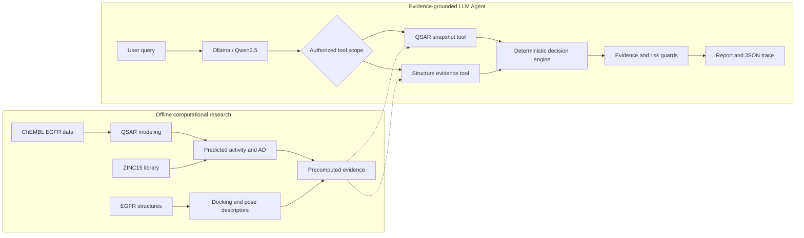
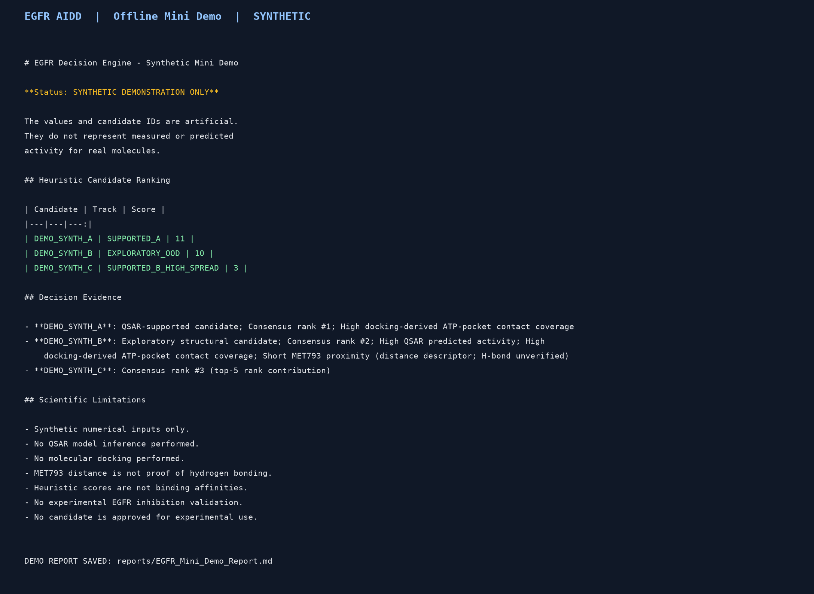

# EGFR AI-Assisted Drug Discovery Pipeline

An evidence-grounded computational drug discovery workflow integrating QSAR modeling, molecular docking, candidate prioritization, and a local LLM-powered Agent.

**Status:** Research prototype with a reproducible offline demonstration.

## 1. Project Overview

This project investigates computational prioritization of potential EGFR inhibitors through:

1. ChEMBL activity data processing and molecular standardization.
2. Scaffold-aware QSAR modeling and evaluation.
3. EGFR receptor preparation and docking protocol assessment.
4. ZINC15-derived compound screening.
5. QSAR applicability-domain and uncertainty analysis.
6. Structure-based candidate evidence integration.
7. Evidence-grounded LLM Agent decision support.

The full scientific workflow requires external datasets, trained models, molecular structures, and docking software.

## 2. LLM Agent Architecture

The Agent uses a local Ollama-compatible language model for authorized tool calling.

Core components:

- QSAR evidence retrieval.
- Structure evidence retrieval.
- Tool authorization and scope enforcement.
- Deterministic candidate ranking.
- Applicability-domain and uncertainty assessment.
- Manual pose-review integration.
- Scientific report generation.
- JSON execution audit and failure records.

The authoritative candidate ranking is generated by the deterministic decision engine, not directly by the LLM.

### Data-to-decision architecture

The research stages produce evidence before Agent execution.
The LLM orchestrates authorized tool calls; the deterministic
decision engine determines the trusted ranking.

## 3. Repository Structure

- egfr_agent/: Agent implementation and decision modules.
- examples/: Synthetic offline demonstration.
- scripts/: Computational research workflow.
- tests/: Automated tests.
- requirements.txt: Core Python dependencies.
- requirements-research.txt: Additional research dependencies.
- .env.example: Example Ollama configuration.

Raw datasets, trained models, docking outputs, and local reports are excluded from the public repository.

## 4. Quick Start

Python 3.11 is recommended.

Create an environment and install core dependencies:

    python -m venv .venv
    source .venv/bin/activate
    python -m pip install -r requirements.txt

Run the offline demonstration:

    python -m examples.mini_demo

This demonstration uses synthetic candidate evidence and the actual EGFRDecisionEngine implementation.

Expected synthetic ranking:

| Candidate | Evidence category | Score |
|---|---|---:|
| DEMO_SYNTH_A | SUPPORTED_A | 11 |
| DEMO_SYNTH_B | EXPLORATORY_OOD | 10 |
| DEMO_SYNTH_C | SUPPORTED_B_HIGH_SPREAD | 3 |

The scores are heuristic prioritization scores, not predicted binding affinities or experimental measurements.

The demonstration generates:

    reports/EGFR_Mini_Demo_Report.md

### Synthetic offline demo output

*Terminal-style rendering generated from actual Mini Demo output.
All candidates are synthetic; no new docking or QSAR inference occurs.*

## 5. Testing

Run the complete automated test discovery:

    python -m unittest discover -s tests -p "test_*.py" -v

Verified in the existing Python environment on October 9, 2026:

- Full local research environment: 30 tests passed.
- Isolated directory without research data: 22 passed, 8 skipped.
- Offline Mini Demo: successful.

Integration tests requiring unavailable research evidence are explicitly skipped.

These results do not establish fresh-environment installation reproducibility.

## 6. Full Agent Execution

The complete Agent requires:

- An Ollama-compatible API service.
- A locally available tool-calling model.
- Previously generated QSAR and structure evidence files.

The tested local model is qwen2.5:7b.

Example environment configuration:

    export OLLAMA_MODEL="qwen2.5:7b"
    export OLLAMA_API_BASE="http://127.0.0.1:11434"

Run the Agent from the project root:

    python -m egfr_agent.run_agent --query "Analyze EGFR candidate activity and structural evidence."

The Agent retrieves existing computational evidence. It does not retrain QSAR models or perform new molecular docking during the natural-language request.

## 7. Scientific Limitations

- QSAR predictions are not experimentally measured activity.
- Out-of-domain predictions require additional caution.
- Docking scores are not experimental binding affinities.
- Residue proximity does not prove hydrogen-bond formation.
- Local geometry checks do not establish full pose validity.
- Manual pose review is not automatically considered complete.
- Retrospective docking performance limits screening claims.
- Heuristic scores are not calibrated biological probabilities.
- No experimentally validated EGFR inhibitor is claimed.

This project is intended for computational hypothesis generation and research-oriented decision support.

## 8. Reproducibility

The offline Mini Demo runs without the original screening library, trained QSAR models, or docking executables.

Full research reproduction requires additional datasets, model artifacts, external software, and local path configuration. Some research scripts still contain workspace-specific paths.

The public source repository is not a fully self-contained reproduction of the complete screening campaign.

## 9. Technology Stack

Python, Pandas, NumPy, RDKit, scikit-learn, molecular docking tools, Ollama HTTP API, and Qwen2.5.
